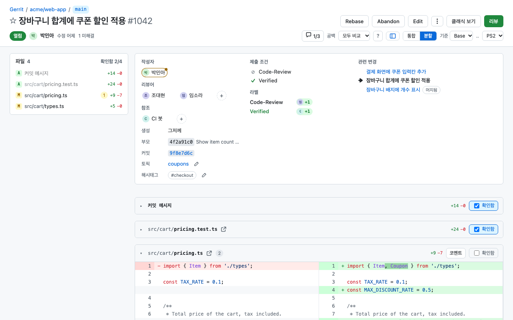
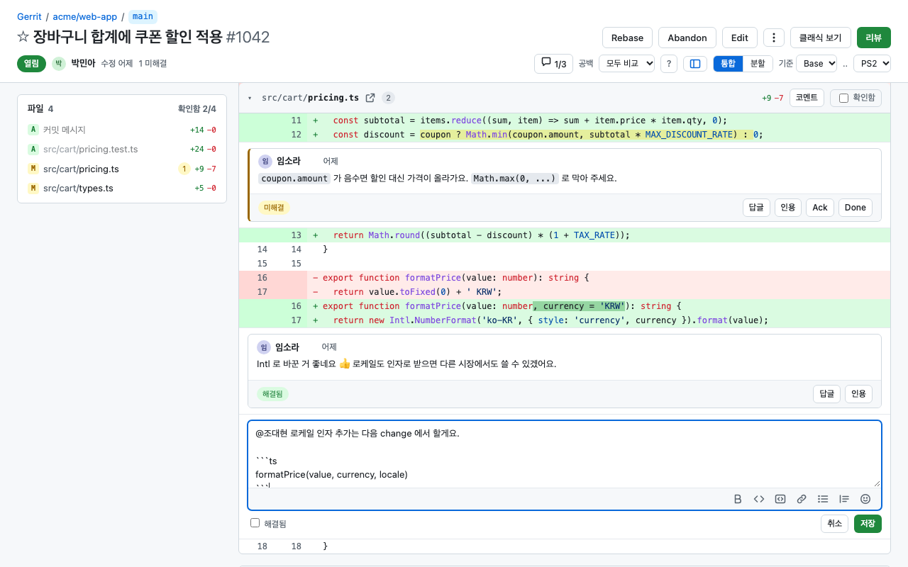
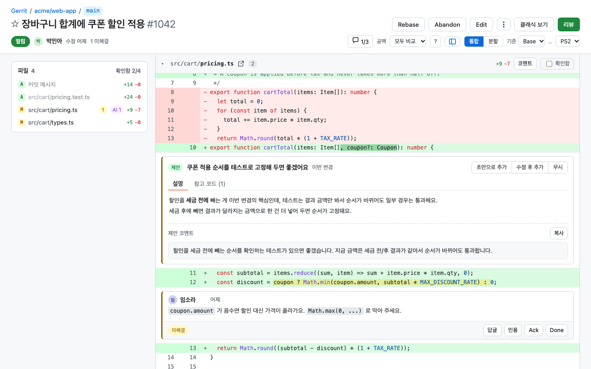

<div align="center">
  
  <h1>Gerrit Lens</h1>
  <p><strong>Gerrit change 를 GitHub 처럼 읽고, AI 리뷰 의견은 줄 옆에서 바로 받는다.</strong></p>
  <p>
    
    
    
    
  </p>
  <p><a href="README.md">English</a> · <strong>한국어</strong></p>
</div>

<p align="center">
  
</p>

Gerrit change 페이지 위에 GitHub 스타일 리뷰 화면을 덮어 보여주는 Chrome 확장이다. 이미 로그인한 세션으로
Gerrit REST API 를 직접 부르므로 중간 서버도, 따로 가입할 계정도 없다.

비공식 확장이다. Gerrit 프로젝트와 관계없다.

## 뭘 하는가

**읽기**
- 파일 목록(코멘트 수, 확인함), 통합/분할 diff, 구문 강조, 줄 안에서 바뀐 글자 표시, 공백 비교 설정
- 바뀌지 않은 긴 구간은 접고, 코멘트가 걸린 곳은 펼친다
- 패치셋, 기준 패치셋 선택. 기본값은 사용자의 Gerrit 설정(분할 보기, 앞뒤 줄 수, 탭 크기 등)을 따른다
- 요약: 작성자, 리뷰어/참조 추가와 제거, 차례(attention set), 제출 조건, 라벨, 토픽, 해시태그, 관련 변경, 함께 머지될 변경, 같은 토픽, 충돌하는 변경, 머지 충돌
- 대화 목록은 Gerrit 처럼 한 줄씩, 누르면 펼쳐져 그 리뷰의 코멘트까지 보인다

**리뷰하기**
- 줄, 드래그한 범위, 파일 코멘트. 답글, 인용, Ack, Done, 초안 수정/삭제
- 서식 툴바, 이모지, @멘션 자동완성, Ctrl/Cmd+Enter 저장, Esc 취소
- 이전 패치셋의 미해결 스레드를 새 패치셋 줄로 옮겨 보여준다 (Gerrit ported comments)
- 리뷰 창에서 메시지, 라벨 투표, 초안 일괄 게시
- Gerrit 이 허용하는 동작을 클래식 화면과 같은 이름, 같은 배치로: Submit, Rebase, Abandon, Restore, Revert, Mark as active, `⋮` 메뉴의 Cherry pick, Download patch, Delete change, Follow-up, Mark as work in progress, Mark private, Move change. Edit 는 Gerrit 편집 모드로 바로 연다
- 단축키: `j`/`k` 파일, `n`/`p` 변경, `Shift+N`/`Shift+P` 미해결 스레드, `a` 리뷰 창, `Shift+C` 스레드 목록, `v` 확인함, `t` 파일 목록, `s` 통합/분할, `?` 도움말
- 코드를 복사하면 코드만 복사된다 (+/- 표시, 줄 번호, 코멘트 제외)

<p align="center">
  
</p>

잠깐 Gerrit 원래 화면이 필요하면 오른쪽 위 **클래식 보기**, 돌아올 땐 Gerrit 상단 헤더의 **LENS**.

## 설치

**Chrome 웹스토어:** 심사 중

**소스에서:**

```bash
git clone https://github.com/osntak/gerrit-lens.git
cd gerrit-lens
npm run zip          # gerrit-lens-v<버전>.zip
```

`chrome://extensions` 에서 개발자 모드를 켜고 폴더를 "압축해제된 확장 프로그램 로드" 로 연다.
Gerrit change 탭에서 확장 아이콘을 누르고 **이 사이트에서 사용** 을 누르면 그 Gerrit 주소에만 권한을 받는다.

지원 범위: PolyGerrit 웹 UI 를 쓰는 Gerrit 3.x. 주소 루트와 `/r/`, `/gerrit/` 같은 하위 경로 모두 된다. 3.8, 3.10(하위 경로), 3.13 에서 확인했다.
파일이 많은 change 는 화면에 가까워진 파일만 불러오고, 바뀐 줄이 3,000줄 넘는 파일은 "불러오기" 를 눌러야 연다.
Gerrit 플러그인이 붙이는 탭(CI 요약 등)은 Lens 에 없다. 필요하면 "클래식 보기" 로 본다.

## AI 리뷰 의견 (선택)

<p align="center">
  
</p>

내 컴퓨터에서 도는 작은 브리지(`gerrit-lens-bridge`)가 Claude Code / Codex 와 확장을 잇는다.

- AI 도구 쪽: MCP 서버(stdio). `add_review_notes`, `list_review_notes`, `remove_review_notes`
- 확장 쪽: `127.0.0.1:7357` HTTP. Host 가 127.0.0.1/localhost 인 요청만 받고, Origin 이 있으면 `chrome-extension://` 이어야 한다
- 의견은 `~/.gerrit-lens/notes/<change번호>.json` 에 쌓인다. change 번호로 구분하므로 change 마다 서버를 띄울 필요가 없다

설정은 팝업의 **AI 의견 (선택)** 에 나오는 두 단계가 전부다.

1. 쓰는 도구에 맞는 명령을 한 번 실행 (Node 18 이상)
   ```bash
   claude mcp add --scope user gerrit-lens -- npx -y gerrit-lens-bridge
   codex mcp add gerrit-lens -- npx -y gerrit-lens-bridge
   ```
2. 팝업에서 **연결 허용**

그다음 AI 도구에 Gerrit 링크를 주고 리뷰를 부탁하면 의견이 줄 옆에 카드로 뜬다. AI 세션 없이 확장만 쓸 땐
`npx -y gerrit-lens-bridge --http` 로 HTTP 만 띄워 둔다.

### 의견 하나의 모양

```json
{
  "file": "src/cart/pricing.ts",
  "line": 10,
  "lineText": "export function cartTotal(items: Item[], coupon?: Coupon): number {",
  "severity": "should",
  "title": "쿠폰 적용 순서를 테스트로 고정해 두면 좋겠어요",
  "context": "이번 변경",
  "body": "할인을 **세금 전에** 빼는 게 핵심인데, 테스트는 결과 금액만 봐요.",
  "refs": [{ "file": "src/cart/pricing.test.ts", "line": 13, "code": "...", "note": "..." }],
  "gerritText": "할인을 세금 전에 빼는 순서를 확인하는 테스트가 있으면 좋겠습니다."
}
```

- `severity`: `must` 문제, `should` 제안, `nit`, `info` 참고 (Conventional Comments)
- `lineText` 를 주면 다른 패치셋이나 줄 번호가 틀린 경우에도 같은 내용의 줄을 찾아 붙이고 "PS1 기준" 표시를 단다
- 카드 버튼: **초안으로 추가** 는 `gerritText` 를 그 줄의 Gerrit 초안으로 만든다. **수정 후 추가** 는 편집기를 연다. **무시** 는 접는다.
  어느 쪽이든 바로 게시하지 않는다. 게시는 리뷰 창의 **보내기** 로 직접 한다
- 확장에서 누른 결과(`posted`, `dismissed`)는 `list_review_notes` 로 다시 읽을 수 있다

## 개발

```bash
npm test       # core 단위 테스트 + 브리지 MCP/HTTP 통합 테스트
```

| 파일 | 역할 |
| --- | --- |
| `core.js` | URL 해석, diff 행, 줄 안 변경 위치, 구문 강조 줄 나누기, 스레드, 의견 위치, 마크다운, 문구 (DOM 없음, Node 에서 테스트) |
| `lens.js` | content script. shadow root 안에 화면을 그리고 Gerrit REST 호출 |
| `lens_css.js` | 화면 스타일 (web_accessible_resources 없이 넣으려고 JS 문자열) |
| `service_worker.js` | 허용한 Gerrit origin 에 content script 등록, 브리지 요청 중계 |
| `vendor/highlight.min.js` | highlight.js 11.9.0 (BSD-3-Clause) |
| `bridge/server.js` | MCP + HTTP 브리지. 의존성 없음, npm `gerrit-lens-bridge` |
| `store-assets/` | 스토어 이미지와, 그걸 가상 데이터로 다시 찍는 `demo/` |

스토어 등록 절차와 문구는 [STORE-LISTING.md](STORE-LISTING.md).

## 라이선스

MIT
