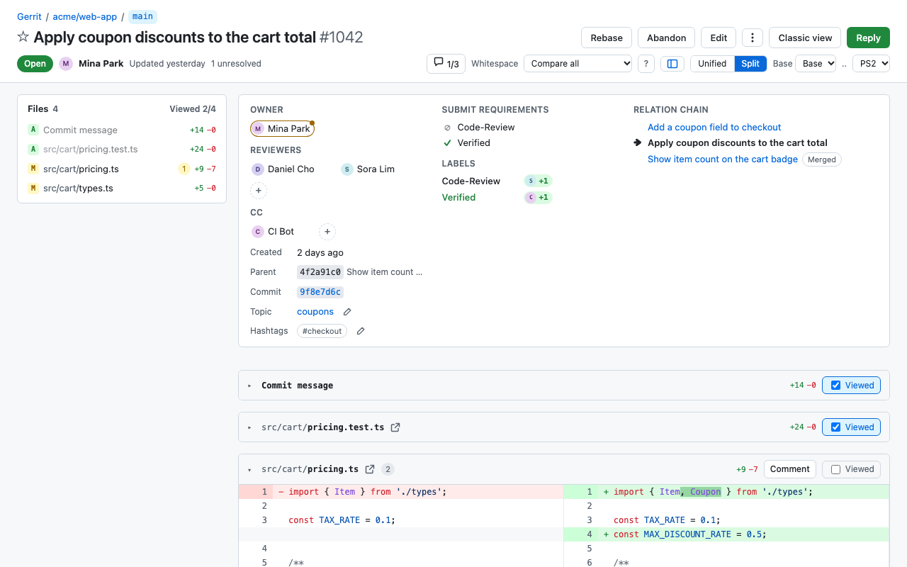
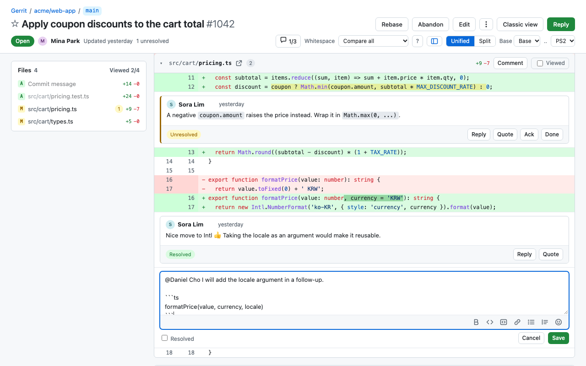
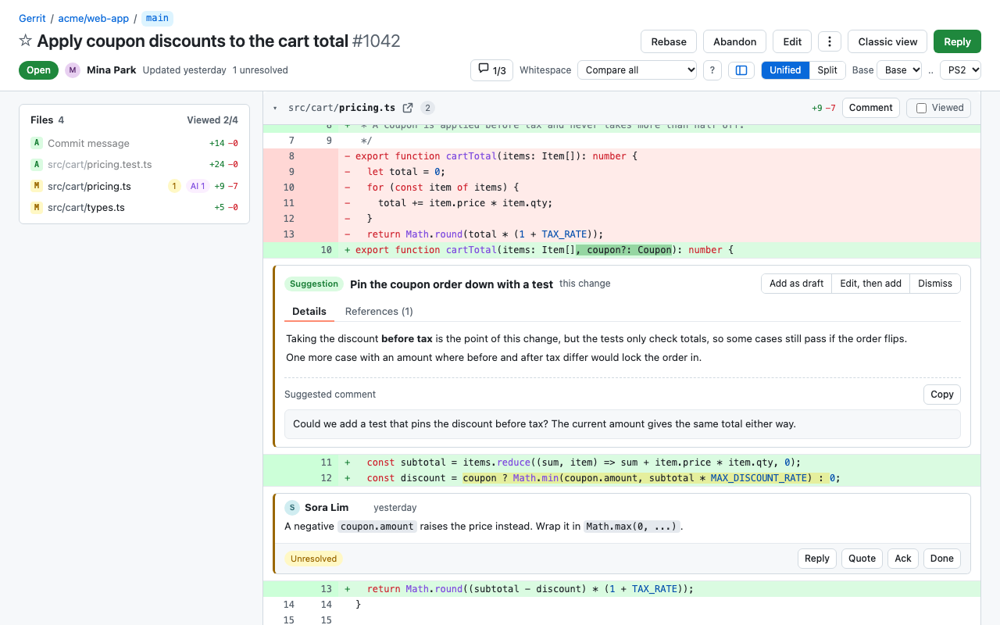

<div align="center">
  
  <h1>Gerrit Lens</h1>
  <p><strong>Read Gerrit changes like a GitHub pull request, with AI review notes right next to the lines.</strong></p>
  <p>
    
    
    
    
  </p>
  <p><strong>English</strong> · <a href="README.ko.md">한국어</a></p>
</div>

<p align="center">
  
</p>

A Chrome extension that puts a GitHub-style review screen over Gerrit change pages. It calls Gerrit's REST API
with the session you are already signed in with, so there is no server in between and no extra account.

Unofficial. Not affiliated with the Gerrit project.

## What it does

**Reading**
- File list (comment counts, Viewed), unified or split diff, syntax colors, changed characters inside a line, whitespace options
- Long unchanged runs fold away and open around comments
- Patchset and base selectors. Defaults follow your own Gerrit preferences (diff view, context lines, tab size, ...)
- Summary: owner, reviewers and CC (add or remove), attention set, submit requirements, labels, topic, hashtags, relation chain, submitted together, same topic, conflicts with, merge conflict
- Conversation in one line per message like Gerrit; click to open the text and the inline comments of that review

**Reviewing**
- Line, selected range and file comments. Reply, Quote, Ack, Done, edit or delete drafts
- Markdown toolbar, emoji, @mention suggestions, Ctrl/Cmd+Enter to save, Esc to cancel
- Unresolved threads from earlier patchsets show on the new patchset's lines (Gerrit ported comments)
- Review dialog with message, label votes and all drafts sent at once
- Gerrit's own actions with the same names and placement as the classic page: Submit, Rebase, Abandon, Restore, Revert, Mark as active, and in the `⋮` menu Cherry pick, Download patch, Delete change, Follow-up, Mark as work in progress, Mark private, Move change. Edit opens Gerrit's edit mode
- Shortcuts: `j`/`k` file, `n`/`p` change, `Shift+N`/`Shift+P` unresolved thread, `a` review dialog, `Shift+C` thread list, `v` viewed, `t` file list, `s` unified/split, `?` help
- Copying code copies only the code (no +/- markers, line numbers or comments)

<p align="center">
  
</p>

Need Gerrit's own page for a moment? **Classic view** at the top right; the **LENS** button in Gerrit's header brings you back.

## Install

**Chrome Web Store:** in review

**From source:**

```bash
git clone https://github.com/osntak/gerrit-lens.git
cd gerrit-lens
npm run zip          # gerrit-lens-v<version>.zip
```

Turn on developer mode in `chrome://extensions` and load the folder as an unpacked extension.
On a Gerrit change tab, click the extension icon and **Use on this site**. Only that Gerrit address gets access.

Supported: Gerrit 3.x with the PolyGerrit web UI, at the host root or under a sub-path such as `/r/` or `/gerrit/`. Checked on 3.8, 3.10 (sub-path) and 3.13.
Large changes load each file's diff as it comes near the screen; a file with more than 3,000 changed lines waits for "Load diff".
Tabs added by Gerrit plugins (CI summaries and so on) are not in Lens; use "Classic view" for them.

## AI review notes (optional)

<p align="center">
  
</p>

A small bridge on your own computer (`gerrit-lens-bridge`) connects Claude Code / Codex to the extension.

- To your AI tool it is an MCP server (stdio): `add_review_notes`, `list_review_notes`, `remove_review_notes`
- To the extension it is HTTP on `127.0.0.1:7357`. It answers only loopback hosts, and only `chrome-extension://` origins when an Origin is sent
- Notes are stored in `~/.gerrit-lens/notes/<change>.json`, keyed by change number, so one bridge serves every change

Setup is the two steps under **AI notes (optional)** in the popup:

1. Run the command for your tool once (Node 18+)
   ```bash
   claude mcp add --scope user gerrit-lens -- npx -y gerrit-lens-bridge
   codex mcp add gerrit-lens -- npx -y gerrit-lens-bridge
   ```
2. Click **Allow connection** in the popup

Then give your AI tool a Gerrit link and ask for a review. Without an AI session, `npx -y gerrit-lens-bridge --http` serves the extension alone.

### What a note looks like

```json
{
  "file": "src/cart/pricing.ts",
  "line": 10,
  "lineText": "export function cartTotal(items: Item[], coupon?: Coupon): number {",
  "severity": "should",
  "title": "Pin the coupon order down with a test",
  "context": "this change",
  "body": "Taking the discount **before tax** is the point, but the tests only check totals.",
  "refs": [{ "file": "src/cart/pricing.test.ts", "line": 13, "code": "...", "note": "..." }],
  "gerritText": "Could we add a test that pins the discount before tax?"
}
```

- `severity`: `must` issue, `should` suggestion, `nit`, `info` note (Conventional Comments)
- With `lineText`, the note finds its line again on later patchsets or when the line number is off, and shows "from PS1"
- Card buttons: **Add as draft** turns `gerritText` into a Gerrit draft on that line, **Edit, then add** opens the editor, **Dismiss** folds it.
  Nothing is published until you press **Send** in the review dialog
- What you did with a note (`posted`, `dismissed`) is visible to the AI through `list_review_notes`

## Development

```bash
npm test       # core unit tests + bridge MCP/HTTP integration test
```

| File | Role |
| --- | --- |
| `core.js` | URL parsing, diff rows, intraline marks, highlighted line splitting, threads, note anchoring, markdown, strings (no DOM, tested in Node) |
| `lens.js` | Content script. Draws the screen in a shadow root and calls Gerrit REST |
| `lens_css.js` | Styles, as a JS string so no web_accessible_resources are needed |
| `service_worker.js` | Registers the content script on allowed Gerrit origins, relays bridge requests |
| `vendor/highlight.min.js` | highlight.js 11.9.0 (BSD-3-Clause) |
| `bridge/server.js` | MCP + HTTP bridge, no dependencies, npm `gerrit-lens-bridge` |
| `store-assets/` | Store images, and `demo/` to retake them with made-up data |

Store submission steps and texts: [STORE-LISTING.md](STORE-LISTING.md).

## License

MIT
